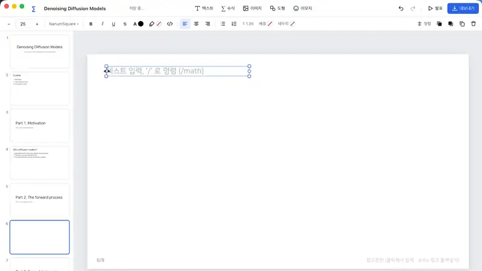
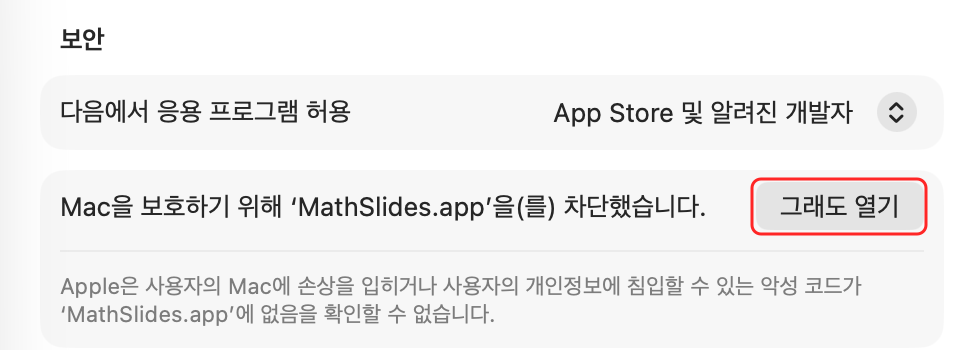
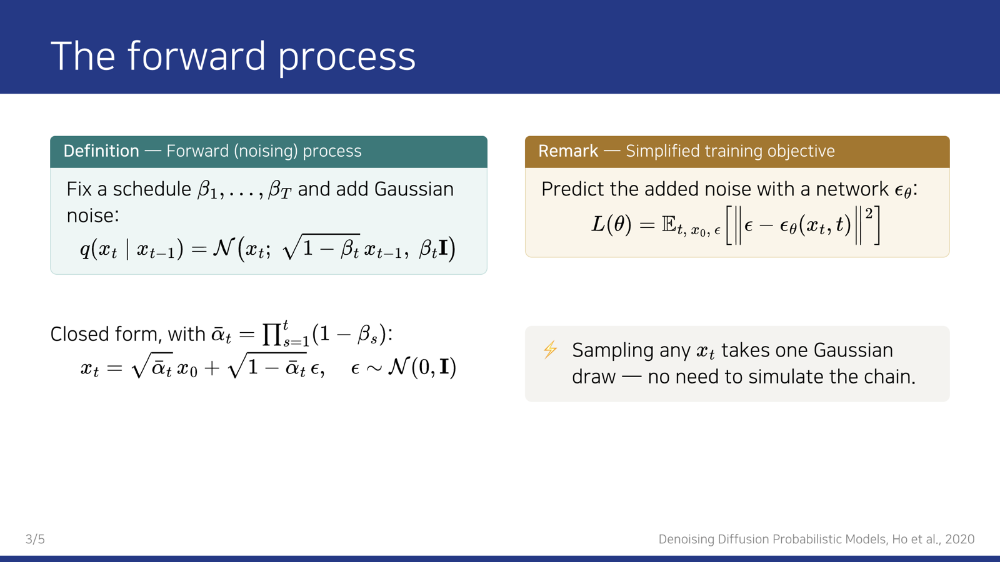
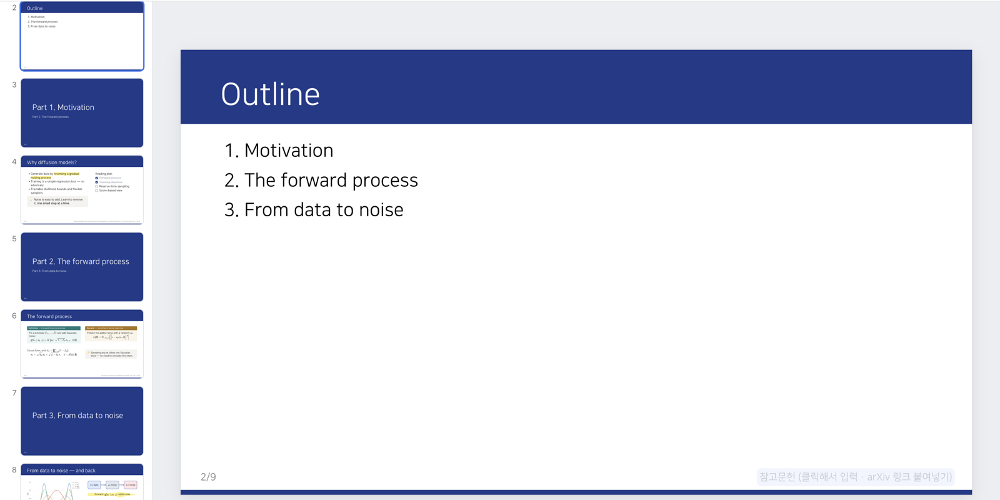
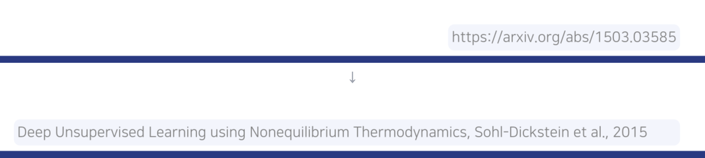
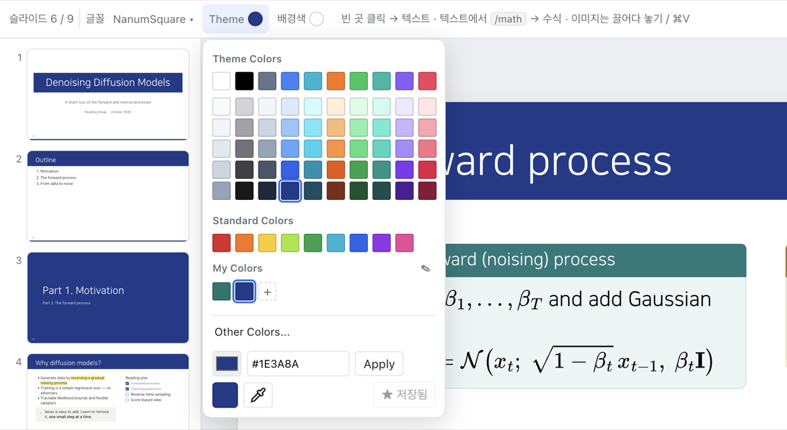

<h1>
  
  MathSlides
</h1>

> **Write like Notion. Math like Overleaf. Present as slides.**

<h3 align="center">
  Simple is Best.<br>
  Less formatting, more thinking. 💙
</h3>

<p align="center">
  <a href="https://kimtona.github.io/math-slides/">
    
  </a>
</p>

<h3 align="center">
  <a href="https://kimtona.github.io/math-slides/">🎬 Watch the Full Video</a> <sub>(1 min)</sub>
</h3>

<p align="center">
  <a href="https://github.com/Kimtona/math-slides/issues/new?template=bug_report.yml">🐞 Report a Bug</a>
  &nbsp;·&nbsp;
  <a href="https://github.com/Kimtona/math-slides/issues/new?template=improvement.yml">💡 Suggest an Improvement</a><br>
  <sub>🎵 Music: <i>Cat Walk</i> by Arulo, from <a href="https://mixkit.co/free-stock-music/cat-walk-371/">Mixkit</a> (<a href="https://mixkit.co/license/#musicFree">Mixkit Stock Music Free License</a>). Not part of this repository's license.</sub>
</p>

## 📦 Installation

Free · No account · Apple Silicon (M1+) · macOS 13+

**[⬇️ Download the latest MathSlides (.dmg)](https://github.com/Kimtona/math-slides/releases/latest)**

1. 📥 **Open** the downloaded `.dmg` and drag **MathSlides** into **Applications**.
2. 🚀 **Launch** it. If macOS shows a warning, click **Done** (not *Move to Trash*).
3. 🔓 **Approve** it in **System Settings → Privacy & Security → Open Anyway**.

<p align="center">
  
</p>

4. 🎉 **Done:** from then on, open MathSlides as usual.

- The warning appears because the app is ad-hoc signed, not notarized. It is a one-time approval per installed version.
- The screenshot is from macOS 26 in Korean; wording differs by version and language (**Done** = 완료, **Open Anyway** = 그래도 열기).
- Standard (non-admin) users are asked for an administrator password when copying to Applications.
- There is no auto-updater. To update, install the newest `.dmg` over the old app (**Replace**). Your files, autosave and preferences are kept.

<details>
<summary>🩺 Troubleshooting</summary>

- **No "Open Anyway" button:** try opening the app once more, then check Privacy & Security again. Managed Macs may block it.
- **"MathSlides is damaged":** use version 1.1.0 or newer (earlier builds had an invalid signature), then verify the download and the installed app. Both commands only read information:

  ```bash
  shasum -a 256 -c SHA256SUMS   # in the folder with the DMG and SHA256SUMS from the release
  codesign --verify --deep --strict --verbose=2 /Applications/MathSlides.app
  ```

  If a check fails, [open an issue](https://github.com/Kimtona/math-slides/issues) with your macOS version and the output.

</details>

## ✨ Features

A local 16:9 slide editor, no account needed. App menus are in Korean; slash commands, LaTeX and shortcuts are language-independent.

<table>
<tr>
<td width="50%" valign="top"><br><b>🧮 LaTeX &amp; Structured Blocks</b><br>Live vector equations plus Theorem, Definition and callout blocks.</td>
<td width="50%" valign="top"><br><b>📑 Automatic Contents &amp; Section Slides</b><br>Write the outline once; linked <i>Part N</i> slides are generated for you.</td>
</tr>
<tr>
<td width="50%" valign="top"><br><b>📚 arXiv Citations</b><br>Paste an arXiv URL in the footer for a citation and an auto-built References slide.</td>
<td width="50%" valign="top"><br><b>🎨 Themes &amp; Colors</b><br>Pick one theme color for the whole deck from presets, saved My Colors, or any HEX value.</td>
</tr>
</table>

> ⚙️ **Make MathSlides yours.**
>
> Customize heading sizes (`#`–`####`), fonts, and other defaults. Apply changes instantly—no restart needed.
>
> `⌘,` → Edit & save → `⌘ + Shift + ,`

<details>
<summary>🔍 More features</summary>

- 📝 **Text:** `#` `##` `###` `####` set sizes 80 / 50 / 30 / 25; bold, italic, underline, strike, text colors, 6 highlights, inline code, links (`⌘K` or a typed URL), `Tab` / `Shift + Tab` to indent lists, `\| ` for a quote. Font size can also be set per paragraph, word or selection.
- 🖼 **Images and tables:** drag-and-drop or paste images; crop, corner radius, and an optional caption on images and tables. Code blocks support Plain Text / Python / C / Bash.
- 🔷 **Shapes:** rectangle, rounded rectangle, ellipse, line, arrow, block arrow (double-click to type in a shape), plus emoji with 10 quick emojis and a searchable picker.
- 📐 **Layout:** alignment guides and snap, align / distribute, z-order, duplicate, nudge. Math has a symbol palette and favorites, and you can color individual symbols of an equation (drag over them, or Shift+← / → from the caret next to it, then use the Text Color palette).
- 🎨 **Style:** a background color per slide; fonts NanumSquare / Pretendard / Noto Serif KR.
- 🎤 **Present and export:** presentation mode, PDF with vector text, editable PPTX with speaker notes ([example PDF](docs/examples/denoising-diffusion-models.pdf)).
- 💾 **Files:** `.mslides` documents, autosave and recovery. Right-click a slide in the list to add Title, Contents or Thank-you slides.

</details>

## 📝 Slash Commands

Type `/` in a text box, then keep typing to filter. Commands marked ● only appear when `/` is the first character of a line.

| Command | Inserts |
|---|---|
| `/math` | Block equation |
| `/inline` | Inline equation (also `⌘ + Shift + E` or `$$x^2$$`) |
| `/code` ● | Code block |
| `/callout` ● | 💡 Callout |
| `/block` ● | Theorem, Definition and other academic blocks |
| `/image` ● | 🖼 Image from a file |
| `/table` ● | 3×3 table |
| `/todo` ● | ☑️ Checklist item |
| `/divider` ● | Horizontal divider (also `---`) |
| `/bullet` | Bulleted list (also `- `) |
| `/number` | Numbered list (also `1. `) |

Extra search words: `/equation` `/latex` `/tex` `/note` `/tip` `/warning` `/theorem` `/definition` `/lemma` `/img` `/photo` `/grid` `/task` `/hr` `/ul` `/ol`.

## ⌨️ Shortcuts

<details>
<summary>Keyboard Shortcuts</summary>

| Action | Shortcut |
|---|---|
| New text box · equation · image | `T` · `M` · `I` (or click an empty spot for text) |
| Rectangle · ellipse · line · arrow | `R` · `O` · `L` · `A` |
| Bold · italic · underline · link | `⌘B` · `⌘I` · `⌘U` · `⌘K` |
| Inline equation | `⌘ + Shift + E` |
| Undo · redo | `⌘Z` · `⌘ + Shift + Z` |
| Copy · paste · cut · duplicate | `⌘C` · `⌘V` · `⌘X` · `⌘D` |
| Nudge (×10) | Arrow keys (`Shift + Arrow`) |
| Bring forward · send backward (to front / back) | `⌘]` · `⌘[` (add `Shift` for front / back) |
| Quick Draw: red highlight box (over anything; `Esc` cancels) | Hold `⌥ + Shift` and drag |
| Disable snapping · preview guides | Hold `⌥` while dragging · hold `Shift` on empty canvas |
| Present | `⌘↵` or `F5` |
| Export PDF · PPTX | `⌘P` · `⌘E` |
| Save · save as · open | `⌘S` · `⌘ + Shift + S` · `⌘O` |
| Open config file · apply it | `⌘,` · `⌘ + Shift + ,` |

</details>

## 🖊️ Sketch-to-Slides (AI)

*Think on paper. Present with MathSlides.* Draw a slide on paper or in GoodNotes, paste the photo or screenshot on a slide, select it and press **Convert to Editable Slide** (image toolbar). A vision model (local via Ollama by default, or Claude) reads the sketch and MathSlides rebuilds it from ordinary, editable elements: text boxes, LaTeX equations (`/math` blocks, never pictures), outlined shapes with their labels, arrows and connector lines, in the ink colors and the layout you drew.

### Setup

By default the sketch is read by a **local vision model through [Ollama](https://ollama.com)**: free, offline after the
download, and the image never leaves your computer. Claude (Anthropic API) can be chosen instead in **AI settings…**
(more accurate, paid).

**Local model (default)**

1. Install Ollama (macOS: download the app from ollama.com, or `brew install ollama`) and start it (the app, or `ollama serve`).
   It listens on `http://localhost:11434`.
2. Download the vision model (≈ 6 GB; runs on an Apple Silicon Mac with 16 GB+ RAM):
   ```bash
   ollama pull qwen2.5vl:7b
   ```
3. `npm install`, then `npm run app`. Nothing else to configure; no key.

Expect about **75–105 s per sketch** on a MacBook Air M-series with 24 GB (measured; most of it is the model writing
its answer). The first call after starting Ollama also loads the model (≈ 3–15 s).

**Claude (optional)**: choose *Claude* in **AI settings…** and enter an Anthropic API key (stored encrypted with the OS
keychain via Electron `safeStorage` as `ai-key.bin` in the app's user-data folder), or start the app with
`ANTHROPIC_API_KEY=sk-ant-...`. The key lives only in the Electron main process; nothing is hard-coded.

Environment overrides (optional): `MATHSLIDES_SKETCH_PROVIDER=ollama|anthropic`, `MATHSLIDES_OLLAMA_MODEL=<name>`,
`OLLAMA_HOST=<host:port>`, `MATHSLIDES_SKETCH_MODEL=<Claude model id>` (default `claude-opus-5-5`),
`MATHSLIDES_SKETCH_LOG=<dir>` to keep a log of every conversion (input image, raw model output, IR, checks, review
screenshots and patches, timings). The feature needs the desktop app (`npm run app`); in browser dev mode the button
is disabled.

**What to expect from the local 7B model** (details and all raw outputs: `docs/SKETCH_DEVLOG.md`,
`examples/ollama-runs/`): diagrams (circles, labels, arrows, connectors) and short text are recognized well; the
equation comes out as editable, renderable LaTeX but with occasional symbol errors (e.g. `r`→`R`); Korean handwriting
is partly misread. That is why every equation and every Korean text from the local model appears under **Check these**
for a quick look before Apply. The AI review loop is off by default with the local model (it did not find real
errors in testing and costs 1–2 minutes); the checkbox turns it on.

### Using it

1. Paste (`⌘V`) or drop the sketch image on a slide (crop it first if it contains more than the slide).
2. Select it → **Convert to Editable Slide**. The dialog shows the original next to the editable result.
3. Look at **Check these**: equations, and anything the model could not read with certainty. For an ambiguous symbol you get *As written* (what is literally on the page, used by default) and *Inferred* (the model's reading from context, e.g. a probable typo). You can edit any text or LaTeX right there.
4. **Apply** replaces the image with the elements (one `⌘Z` brings the image back); **Apply, keep image** keeps it; **Cancel** changes nothing.

The elements are rebuilt **where the image is**: inside its frame on the slide, in the same relative positions (a cropped
image uses its visible part; a stretched one maps like the picture). Nothing else on the slide is moved or changed, so
place or resize the sketch where you want the result before converting. The preview shows the slide with the image area
dashed; *Checks* warns if something would leave that area or cover existing content. Text that needs more room than the
handwriting gets a slightly smaller font rather than being moved onto its neighbours.

### How it works

```text
image ─► vision model (Ollama or Claude, JSON) ─► IR ─► converter ─► deterministic checks ─► preview
                                              ▲                                          │
                                              └──── patches ◄── AI review (≤ 2 rounds) ◄─┘ (original + screenshot)
```

- **IR** (`src/sketch/ir.ts`): elements with kind (`text`/`math`/`shape`/`arrow`/`line`), coordinates normalized 0..1000, text or LaTeX, arrow endpoints and the ids they attach to, relations (`inside`, `annotates`), role (title/label/annotation/body), ink color, and a review flag. The flag is *not* a probability; it only marks what a human should check. The model never writes `.mslides` JSON.
- **Converter** (`src/sketch/convert.ts`): IR coordinates map onto the image's frame on the slide (the command-line tool, which has no slide, fits the content into the slide instead); equation size from MathJax's real typeset size; text inside a shape becomes the shape's text; arrows attached to shapes start and end on their outlines. No auto-beautify (alignment, spacing) yet.
- **Pixel measurements** (`src/sketch/ink.ts`): colored outlines are measured on the image the model saw — color (stroke core, white-balanced against the paper, so a dim photo still gives the color as drawn), thickness, and whether it is a highlighter (light + thick) — and straight arrows that clearly bend in the ink become curves. Nothing is invented: no measurement, no change; a model-given control point or bend is kept. Highlighters are thick light outlines under the text (shapes are drawn first, so no transparency is needed).
- **Structure** (tables, formatting, lists): a screenshot of a table becomes the editor's own **Table** (rows × columns, header row, cells editable one by one); bold / italic / strikethrough become real marks; bullet and numbered lists become real lists; a heading becomes a larger paragraph; a quoted passage becomes a block quote; equations stay `/math` equations. Nothing is left as Markdown characters or as a picture. The local model's answer is hardened first: a cut-off or looping answer keeps only its finished elements, repeated elements are dropped, and separate cell boxes that form a grid are grouped into one table (the result is flagged for review). With the 7B model, tables, headings, quotes and lists are recovered; **bold/italic/strikethrough are not recognized** (it writes no formatting). Not supported yet: merged cells, math or lists inside table cells, nested lists.
- **Math in text**: inline math written as `$...$`, `$$...$$`, `\(...\)` or `\[...\]` becomes the editor's inline equations (MathJax); display equations lose only their delimiters. Long equations are scaled by their real typeset width to fit; paragraphs wrap within the image area.
- **Checks** (`src/sketch/validate.ts`): structure, slide bounds, leaving the image area, covering existing slide content, LaTeX that does not render, unsupported elements, unintended overlaps (labels in shapes, notes on what they annotate and connectors are allowed to touch).
- **AI review**: a second request compares the original with a screenshot of the converted slide (+ the IR and the check results) and returns patches for real conversion errors only, never "improvements" to the writer's content.
- Prompts: `electron/sketch-prompts.cjs` (Claude prompt + a shorter local-model prompt). Model calls: `electron/sketch-ai.cjs` (Claude) and `electron/sketch-ollama.cjs` (Ollama); the local model's flat pixel format is converted to the IR by `electron/sketch-local.cjs`. Settings, key storage and IPC: `electron/sketch-main.cjs`.

### Command line (no GUI)

```bash
npm run sketch -- examples/sketches/policy-gradient.png --out sketch-out             # local model (Ollama)
ANTHROPIC_API_KEY=sk-ant-... npm run sketch -- my-sketch.png --provider anthropic     # Claude
# offline, from a saved model output (no model call; also re-applies the local-format conversion):
npm run sketch -- examples/sketches/diagram-abc.png --ir examples/ollama-runs/exp4/test1.ir.json
node scripts/render-mslides.mjs sketch-out/policy-gradient.mslides out.png          # look at the result
```

It writes `<name>.ir.json` (raw model text and output), `<name>.mslides` (open it in MathSlides) and `<name>.report.json`
(checks, timings, token usage); a failed model call leaves `<name>.failed.json`. Like the app, it resizes the image for
the model (macOS `sips`, then all PNG metadata chunks — EXIF incl. GPS, text — are removed; `sips` alone keeps EXIF), and runs the same pixel measurements as the app. The AI review loop needs the rendered slide, so it runs in
the app only.

### Tests

`node tests/sketch-convert.mjs` (IR parsing, local-model format, conversion, LaTeX handling, checks; headless), `node tests/sketch-dialog.mjs` (the dialog end to end in Electron) and `node tests/sketch-latex.mjs` (a real model output for a paper capture replayed in Electron: inline/display math rendering, layout, save/reopen, PDF, PPTX). With Ollama running, `node tests/sketch-ollama-e2e.mjs <out-dir> <image>...` drives the real app with the real local model (convert → Apply → edit → Undo/Redo → save, PDF, PPTX) and writes screenshots, outputs and measured times to `<out-dir>` (not part of `npm test`). The GUI test replaces the model with a fixture (`MATHSLIDES_SKETCH_FAKE=<ir.json>`, shown as "fake (test fixture)" in the dialog), so it needs no key or network. The fixtures in `tests/fixtures/sketch/` are hand-written expected recognitions, not model output.

### Measuring time saved

For a fair comparison, use the same sketch for both: (1) with a stopwatch, rebuild it by hand in MathSlides until it matches the sketch; (2) with a stopwatch, convert it and fix whatever needs fixing until it matches. Record both times and the number of manual fixes in `docs/SKETCH_DEVLOG.md`. The dialog shows the conversion time, and the run log has per-step timings.

## 🔧 Configuration

Press **`⌘,`** to make MathSlides yours: set the font sizes for `#`, `##`, `###` and `####`, pick the default font, and tune the default look of shapes and images.

1. **`⌘,`** opens `config.txt` in your text editor.
2. Change a value and save.
3. **`⌘ + Shift + ,`** in MathSlides applies it, with no restart.

```ini
# Font
font = NanumSquare

# Text sizes: #, ##, ###, ####
heading-1 = 80
heading-2 = 50
heading-3 = 30
body-size = 25

# Shapes and images
shape-fill = none
shape-stroke = #000000
shape-stroke-width = 1px
image-radius-preset = 50px
```

`font` can be NanumSquare, Pretendard or Noto Serif KR. Changes apply to new content only, and a mistake in the file is reported while your last working settings stay active.

<sub>Building from source, tests and releases: [docs/DEVELOPMENT.md](docs/DEVELOPMENT.md).</sub>

## 🗺️ Roadmap

Ideas for future updates:

- 🪟 **Windows Support** — Bring MathSlides to Windows.
- 📝 **Notion → MathSlides** — Turn Notion notes into presentation slides automatically.
- 🏷️ **More Slash Commands** — Add `/badge` and other presentation-friendly blocks.

Have an idea of your own? [Suggest an Improvement](https://github.com/Kimtona/math-slides/issues/new?template=improvement.yml).

---

<p align="center">
  Made with ❤️ for researchers.<br>
  If you find MathSlides useful, consider giving it a ⭐!
</p>
