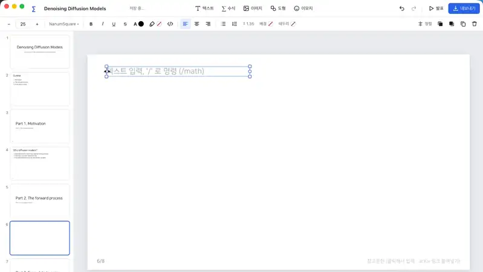
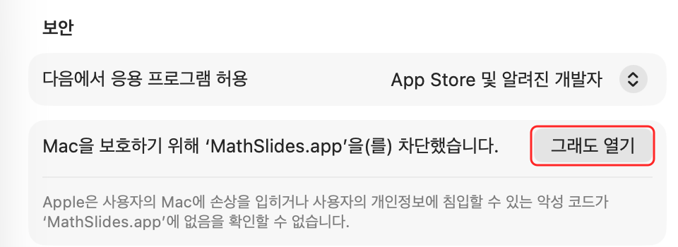
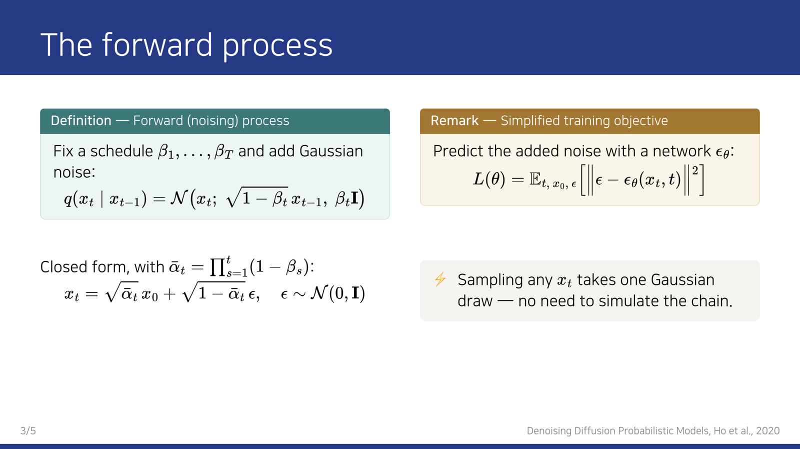
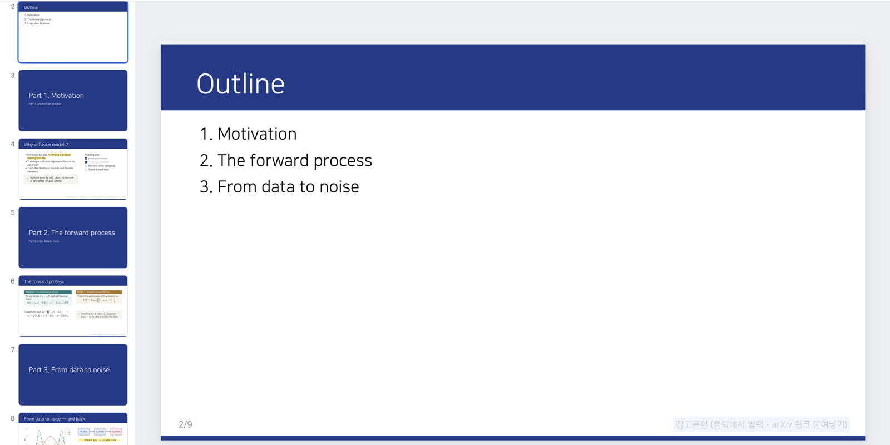
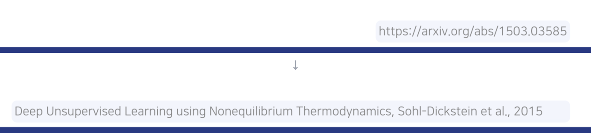
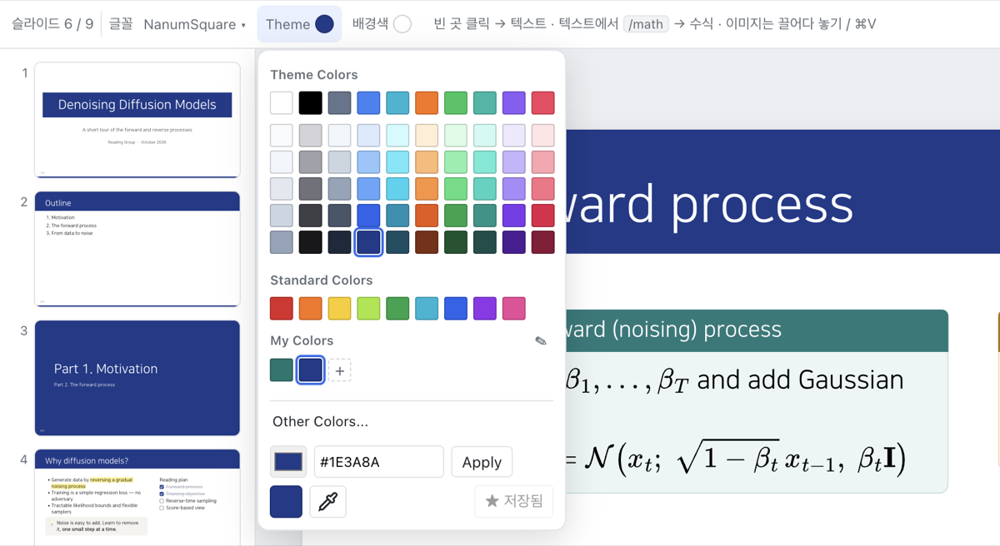

<h1>
  
  MathSlides
</h1>

> **Write like Notion. Math like Overleaf. Present as slides.**

<h3 align="center">
  Simple is Best.<br>
  Less formatting, more thinking. 💙
</h3>

<p align="center">
  <a href="https://kimtona.github.io/math-slides/">
    
  </a>
</p>

<h3 align="center">
  <a href="https://kimtona.github.io/math-slides/">🎬 Watch the Full Video</a> <sub>(1 min)</sub>
</h3>

<p align="center">
  <a href="https://github.com/Kimtona/math-slides/issues/new?template=bug_report.yml">🐞 Report a Bug</a>
  &nbsp;·&nbsp;
  <a href="https://github.com/Kimtona/math-slides/issues/new?template=improvement.yml">💡 Suggest an Improvement</a><br>
  <sub>🎵 Music: <i>Cat Walk</i> by Arulo, from <a href="https://mixkit.co/free-stock-music/cat-walk-371/">Mixkit</a> (<a href="https://mixkit.co/license/#musicFree">Mixkit Stock Music Free License</a>). Not part of this repository's license.</sub>
</p>

## 📦 Installation

Free · No account · Apple Silicon (M1+) · macOS 13+

**[⬇️ Download the latest MathSlides (.dmg)](https://github.com/Kimtona/math-slides/releases/latest)**

1. 📥 **Open** the downloaded `.dmg` and drag **MathSlides** into **Applications**.
2. 🚀 **Launch** it. If macOS shows a warning, click **Done** (not *Move to Trash*).
3. 🔓 **Approve** it in **System Settings → Privacy & Security → Open Anyway**.

<p align="center">
  
</p>

4. 🎉 **Done:** from then on, open MathSlides as usual.

- The warning appears because the app is ad-hoc signed, not notarized. It is a one-time approval per installed version.
- The screenshot is from macOS 26 in Korean; wording differs by version and language (**Done** = 완료, **Open Anyway** = 그래도 열기).
- Standard (non-admin) users are asked for an administrator password when copying to Applications.
- There is no auto-updater. To update, install the newest `.dmg` over the old app (**Replace**). Your files, autosave and preferences are kept.

<details>
<summary>🩺 Troubleshooting</summary>

- **No "Open Anyway" button:** try opening the app once more, then check Privacy & Security again. Managed Macs may block it.
- **"MathSlides is damaged":** use version 1.1.0 or newer (earlier builds had an invalid signature), then verify the download and the installed app. Both commands only read information:

  ```bash
  shasum -a 256 -c SHA256SUMS   # in the folder with the DMG and SHA256SUMS from the release
  codesign --verify --deep --strict --verbose=2 /Applications/MathSlides.app
  ```

  If a check fails, [open an issue](https://github.com/Kimtona/math-slides/issues) with your macOS version and the output.

</details>

## ✨ Features

A local 16:9 slide editor, no account needed. App menus are in Korean; slash commands, LaTeX and shortcuts are language-independent.

<table>
<tr>
<td width="50%" valign="top"><br><b>🧮 LaTeX &amp; Structured Blocks</b><br>Live vector equations plus Theorem, Definition and callout blocks.</td>
<td width="50%" valign="top"><br><b>📑 Automatic Contents &amp; Section Slides</b><br>Write the outline once; linked <i>Part N</i> slides are generated for you.</td>
</tr>
<tr>
<td width="50%" valign="top"><br><b>📚 arXiv Citations</b><br>Paste an arXiv URL in the footer for a citation and an auto-built References slide.</td>
<td width="50%" valign="top"><br><b>🎨 Themes &amp; Colors</b><br>Pick one theme color for the whole deck from presets, saved My Colors, or any HEX value.</td>
</tr>
</table>

<details>
<summary>🔍 More features</summary>

- 📝 **Text:** `#` `##` `###` `####` set sizes 80 / 50 / 30 / 25; bold, italic, underline, strike, text colors, 6 highlights, inline code, links (`⌘K` or a typed URL), `Tab` / `Shift + Tab` to indent lists, `\| ` for a quote. Font size can also be set per paragraph, word or selection.
- 🖼 **Images and tables:** drag-and-drop or paste images; crop, corner radius, and an optional caption on images and tables. Code blocks support Plain Text / Python / C / Bash.
- 🔷 **Shapes:** rectangle, rounded rectangle, ellipse, line, arrow, block arrow (double-click to type in a shape), plus emoji with 10 quick emojis and a searchable picker.
- 📐 **Layout:** alignment guides and snap, align / distribute, z-order, duplicate, nudge. Math has a symbol palette and favorites.
- 🎨 **Style:** a background color per slide; fonts NanumSquare / Pretendard / Noto Serif KR.
- 🎤 **Present and export:** presentation mode, PDF with vector text, editable PPTX with speaker notes ([example PDF](docs/examples/denoising-diffusion-models.pdf)).
- 💾 **Files:** `.mslides` documents, autosave and recovery. Right-click a slide in the list to add Title, Contents or Thank-you slides.

</details>

## 📝 Slash Commands

Type `/` in a text box, then keep typing to filter. Commands marked ● only appear when `/` is the first character of a line.

| Command | Inserts |
|---|---|
| `/math` | Block equation |
| `/inline` | Inline equation (also `⌘ + Shift + E` or `$$x^2$$`) |
| `/code` ● | Code block |
| `/callout` ● | 💡 Callout |
| `/block` ● | Theorem, Definition and other academic blocks |
| `/image` ● | 🖼 Image from a file |
| `/table` ● | 3×3 table |
| `/todo` ● | ☑️ Checklist item |
| `/divider` ● | Horizontal divider (also `---`) |
| `/bullet` | Bulleted list (also `- `) |
| `/number` | Numbered list (also `1. `) |

Extra search words: `/equation` `/latex` `/tex` `/note` `/tip` `/warning` `/theorem` `/definition` `/lemma` `/img` `/photo` `/grid` `/task` `/hr` `/ul` `/ol`.

## ⌨️ Shortcuts

<details>
<summary>Keyboard Shortcuts</summary>

| Action | Shortcut |
|---|---|
| New text box · equation · image | `T` · `M` · `I` (or click an empty spot for text) |
| Rectangle · ellipse · line · arrow | `R` · `O` · `L` · `A` |
| Bold · italic · underline · link | `⌘B` · `⌘I` · `⌘U` · `⌘K` |
| Inline equation | `⌘ + Shift + E` |
| Undo · redo | `⌘Z` · `⌘ + Shift + Z` |
| Copy · paste · cut · duplicate | `⌘C` · `⌘V` · `⌘X` · `⌘D` |
| Nudge (×10) | Arrow keys (`Shift + Arrow`) |
| Bring forward · send backward (to front / back) | `⌘]` · `⌘[` (add `Shift` for front / back) |
| Disable snapping · preview guides | Hold `⌥` while dragging · hold `Shift` on empty canvas |
| Present | `⌘↵` or `F5` |
| Export PDF · PPTX | `⌘P` · `⌘E` |
| Save · save as · open | `⌘S` · `⌘ + Shift + S` · `⌘O` |
| Open config file · apply it | `⌘,` · `⌘ + Shift + ,` |

</details>

## 🔧 Configuration

Press **`⌘,`** to make MathSlides yours: set the font sizes for `#`, `##`, `###` and `####`, pick the default font, and tune the default look of shapes and images.

1. **`⌘,`** opens `config.txt` in your text editor.
2. Change a value and save.
3. **`⌘ + Shift + ,`** in MathSlides applies it, with no restart.

```ini
# Font
font = NanumSquare

# Text sizes: #, ##, ###, ####
heading-1 = 80
heading-2 = 50
heading-3 = 30
body-size = 25

# Shapes and images
shape-fill = none
shape-stroke = #000000
shape-stroke-width = 1px
image-radius-preset = 50px
```

`font` can be NanumSquare, Pretendard or Noto Serif KR. Changes apply to new content only, and a mistake in the file is reported while your last working settings stay active.

<sub>Building from source, tests and releases: [docs/DEVELOPMENT.md](docs/DEVELOPMENT.md).</sub>

---

<p align="center">
  Made with ❤️ for researchers.<br>
  If you find MathSlides useful, consider giving it a ⭐!
</p>
